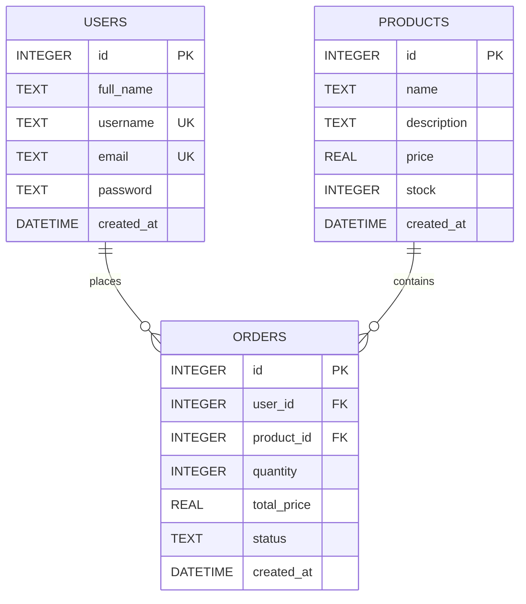

# Week 1 Submission Package: E-Commerce Inventory & Order API

---

## 1. Idea One-Pager

### Project Name
**E-Commerce Inventory & Order REST API**

### One User, One Problem
- **Who it is for (Target User)**: Small online retail store owners and independent merchants managing their own product sales.
- **What pain it removes (Problem Solved)**: Small merchants often track products and orders using manual paper notes or spreadsheets. This causes frequent mistakes, accidental overselling of out-of-stock items, and unorganized customer order records.
- **Solution**: A simple, fast REST API that catalogs products, maintains stock counts, and records orders with automated stock validation.

### The 3 Related Entities
1. **Users (`users`)**
   - Fields: `id` (INTEGER PK), `full_name` (TEXT), `username` (TEXT UNIQUE), `email` (TEXT UNIQUE), `password` (TEXT), `created_at` (DATETIME)
2. **Products (`products`)** — *Main Entity for Week 1*
   - Fields: `id` (INTEGER PK), `name` (TEXT, required), `description` (TEXT), `price` (REAL, required), `stock` (INTEGER, required), `created_at` (DATETIME)
3. **Orders (`orders`)** — *Relational Bridge*
   - Fields: `id` (INTEGER PK), `user_id` (INTEGER FK -> users.id), `product_id` (INTEGER FK -> products.id), `quantity` (INTEGER), `total_price` (REAL), `status` (TEXT), `created_at` (DATETIME)

### Safety & Scope
- Dummy seed data only; no real personal data.
- Manageable in 3 weeks by one person part-time.

---

## 2. One-Page Work Plan

### Weekly Deliverables Plan
- **Week 1**: Idea one-pager, work plan, 1.1 Data model & API design, 1.2 Core CRUD endpoints for main entity (`products`), 5-minute presentation.
- **Week 2**: 2.1 Authentication & authorisation, 2.2 Relationships, validation and errors, issue log.
- **Week 3**: 3.1 Testing, 3.2 Documentation, security, deployment, and final package.

### Top 3 Risks & Mitigation Strategies
1. **Risk 1: Inventory Race Conditions & Overselling**
   - *Mitigation*: Validate that `stock >= quantity` before committing any purchase transaction.
2. **Risk 2: Local Setup Failures Across Different Reviewer Computers**
   - *Mitigation*: Use zero-configuration local SQLite (`ecommerce.sqlite`) so any mentor can clone and run immediately with `npm install` and `npm start` without installing external database software.
3. **Risk 3: Feature Bloat / Scope Creep**
   - *Mitigation*: Strictly stick to the core CRUD and relational models; omit complex file uploads and third-party payment gateways.

---

## 3. Task 1.1 — Data Model and API Design

### Entity-Relationship Diagram (ERD)



### Design Decisions
- **Database Choice**: Relational SQL (SQLite) was chosen because products, users, and orders have clear relational links and foreign key integrity.
- **Main Entity**: `products` is the core entity that powers the catalog.
- **Field Constraints**: `name` and `price` are mandatory because an item cannot exist in a store catalog without an identifier and cost. `stock` defaults to `0` to prevent undefined values.

### REST API Specification (Main Entity: Products)

| Method | Path | Purpose | Request Body | Response Body | Status Codes |
|---|---|---|---|---|---|
| `POST` | `/products` | Create a new product | `{"name": string, "description": string, "price": number, "stock": number}` | `{"message": "Product created successfully", "product": {...}}` | `201 Created`<br>`400 Bad Request` |
| `GET` | `/products?page=1&limit=10` | List products (paginated) | None | `{"data": [...], "page": 1, "limit": 10, "total": number}` | `200 OK`<br>`500 Server Error` |
| `GET` | `/products/:id` | Get single product by ID | None | `{"id": 1, "name": "...", "price": 89.99, ...}` | `200 OK`<br>`404 Not Found` |
| `PUT` | `/products/:id` | Update product details | `{"name"?: string, "description"?: string, "price"?: number, "stock"?: number}` | `{"message": "Product updated successfully", "product": {...}}` | `200 OK`<br>`400 Bad Request`<br>`404 Not Found` |
| `DELETE` | `/products/:id` | Delete product by ID | None | `{"message": "Product deleted successfully"}` | `200 OK`<br>`404 Not Found` |

---

## 4. Task 1.2 — Core CRUD Endpoints

### Repository & Live Status
- **Public Repository**: [https://github.com/iyanuolakunle1-dot/ecommerce_api](https://github.com/iyanuolakunle1-dot/ecommerce_api)
- **Tag**: `week-1`
- **Live Deployed API**: [https://ecommerce-api-6abw.onrender.com](https://ecommerce-api-6abw.onrender.com)

### How to Run Locally
```bash
# 1. Install dependencies
npm install

# 2. Seed dummy data
node seed.js

# 3. Start the server
node server.js
```
The server starts at `http://localhost:3000`.

### Sample Requests & Expected Responses

#### 1. Create Product (Success: `201 Created`)
```bash
curl -X POST http://localhost:3000/products \
  -H "Content-Type: application/json" \
  -d '{"name": "Wireless Mouse", "description": "Ergonomic 2.4GHz", "price": 29.99, "stock": 20}'
```

#### 2. Create Product (Validation Failure: `400 Bad Request`)
```bash
curl -X POST http://localhost:3000/products \
  -H "Content-Type: application/json" \
  -d '{"description": "Missing name and price"}'
```

#### 3. List All Products (Success: `200 OK`)
```bash
curl -X GET "http://localhost:3000/products?page=1&limit=10"
```

#### 4. Get Single Product (Success: `200 OK`)
```bash
curl -X GET http://localhost:3000/products/1
```

#### 5. Get Non-existent Product (`404 Not Found`)
```bash
curl -X GET http://localhost:3000/products/9999
```

#### 6. Update Product (Success: `200 OK`)
```bash
curl -X PUT http://localhost:3000/products/1 \
  -H "Content-Type: application/json" \
  -d '{"price": 24.99, "stock": 18}'
```

#### 7. Delete Product (Success: `200 OK`)
```bash
curl -X DELETE http://localhost:3000/products/1
```

---

## 5. 5-Minute Presentation to Mentors

- **Minute 1: The Idea (Idea One-Pager)**
  - State the product idea: An E-Commerce Inventory REST API for small store owners.
  - Explain the pain point: Eliminates error-prone manual spreadsheets and stops accidental overselling of out-of-stock items.

- **Minute 2: Data Model & Design (Task 1.1)**
  - Show the ERD diagram with 3 entities: `users`, `products` (main entity), and `orders`.
  - Explain the design decision: SQLite gives local zero-friction setup while maintaining strict SQL foreign key relational integrity.

- **Minute 3: Core CRUD Live Demo — Create & Read (Task 1.2)**
  - Send a `POST /products` request with valid JSON -> show `201 Created`.
  - Send a `POST /products` request with missing fields -> show `400 Bad Request`.
  - Send a `GET /products` request -> show list with pagination metadata (`page`, `limit`, `total`).

- **Minute 4: Core CRUD Live Demo — Single, Update & Delete (Task 1.2)**
  - Send `GET /products/1` -> show single record (`200 OK`).
  - Send `GET /products/999` -> show `404 Not Found`.
  - Send `PUT /products/1` updating the price/stock -> show `200 OK`.
  - Send `DELETE /products/1` -> show `200 OK`.

- **Minute 5: Wrap Up & Mentor Feedback**
  - Highlight the repository structure, `seed.js` dummy data, and git tag `week-1`.
  - Open the floor for mentor questions and write down feedback in your issue log.
