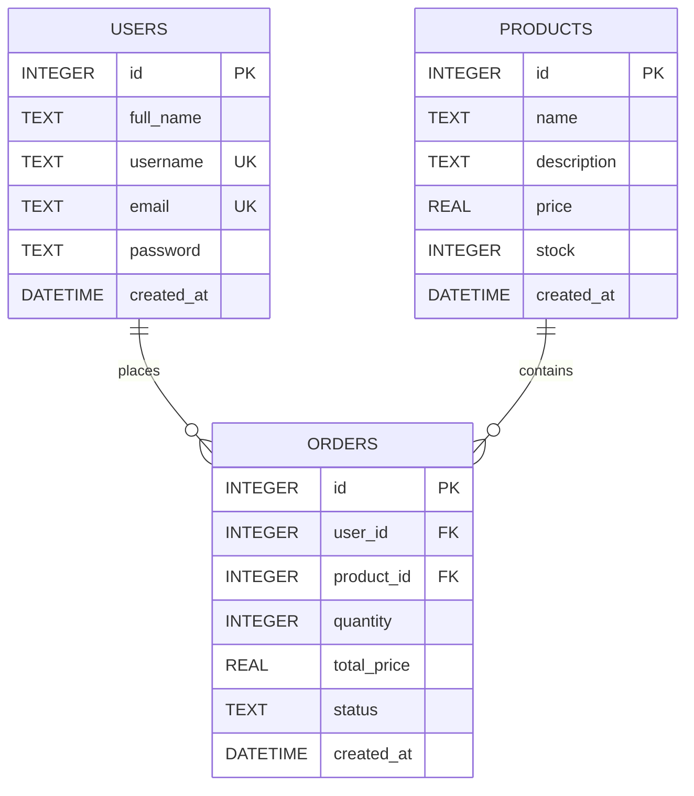

# Week 1 Submission Package: E-Commerce Inventory & Order API

## 1. Idea One-Pager

### Project Title
**E-Commerce Inventory & Order REST API**

### One User, One Problem
- **Target User**: Small online retail store owners and independent merchants who run direct-to-consumer businesses.
- **Problem Statement**: Small merchants often manage products and track orders using manual spreadsheets or disparate notes. This leads to accidental overselling, stockout disputes, and lack of clear transaction records.
- **Pain Removed**: Provides a fast, lightweight, and structured REST API to reliably catalog products, maintain accurate inventory counts, and record orders with automated stock validation and reduction.

### The 3 Core Entities
1. **Users (`users`)**:
   - `id` (INTEGER PRIMARY KEY)
   - `full_name` (TEXT)
   - `username` (TEXT UNIQUE)
   - `email` (TEXT UNIQUE)
   - `password` (TEXT, hashed with bcrypt)
   - `created_at` (DATETIME)
2. **Products (`products`)** — *Main Entity for Week 1*:
   - `id` (INTEGER PRIMARY KEY)
   - `name` (TEXT, required)
   - `description` (TEXT)
   - `price` (REAL, required)
   - `stock` (INTEGER, required)
   - `created_at` (DATETIME)
3. **Orders (`orders`)** — *Relational Junction*:
   - `id` (INTEGER PRIMARY KEY)
   - `user_id` (INTEGER, Foreign Key -> `users.id`)
   - `product_id` (INTEGER, Foreign Key -> `products.id`)
   - `quantity` (INTEGER)
   - `total_price` (REAL)
   - `status` (TEXT, default: 'pending')
   - `created_at` (DATETIME)

### Scope & Safety
- **3-Week Feasibility**: Focused entirely on core CRUD, relational constraints, auth, and validation without complex dependencies like external payment gateways, real-time websockets, or heavy file storage.
- **Data Safety**: Uses only dummy seed data and synthetic test accounts. Passwords are encrypted using bcrypt (10 rounds).

---

## 2. Work Plan (3-Week Breakdown & Top Risks)

| Week | Focus | Deliverables |
|---|---|---|
| **Week 1** | **Design & Build** | - Idea One-Pager & Work Plan.<br>- Task 1.1: Data model (ERD), API specification, schema decisions.<br>- Task 1.2: Core CRUD endpoints for main entity (`products`), input validation, correct HTTP status codes, dummy data seeding, sample HTTP requests, git tag `week-1`.<br>- 5-minute mentor presentation walkthrough. |
| **Week 2** | **Auth & Robustness** | - Task 2.1: JWT authentication & route authorization (`middleware/auth.js`).<br>- Task 2.2: Relational integrity, stock depletion logic on orders (`POST /orders`), comprehensive error handling, and issue log tracking. |
| **Week 3** | **Quality & Delivery** | - Task 3.1: Automated test suite (Jest + Supertest integration tests).<br>- Task 3.2: Complete documentation, cloud deployment (Render live URL), final submission package, git tag `week-3`. |

### Top 3 Risks & Mitigation Strategies
1. **Risk 1: Inventory Race Conditions & Overselling**
   - *Detail*: Two simultaneous requests ordering the last unit could result in negative stock.
   - *Mitigation*: SQLite transaction checks ensure `stock >= quantity` before reducing stock and committing order creation.
2. **Risk 2: Portability & Local Setup Issues on Reviewers' Machines**
   - *Detail*: Cloud-only or heavy database setups (PostgreSQL/Docker) often fail when mentors run code locally.
   - *Mitigation*: Use zero-configuration local SQLite (`ecommerce.sqlite`), ensuring instant out-of-the-box execution with `npm install` and `npm start`.
3. **Risk 3: Scope Creep (Payment Gateways, File Uploads)**
   - *Detail*: Adding Stripe or S3 file storage could easily derail the timeline.
   - *Mitigation*: Strictly enforce the "one user, one problem" mandate: rely on image URLs / descriptions and status-based order records.

---

## 3. Task 1.1 — Data Model & API Specification

### Entity-Relationship Diagram (ERD)



### Design Decisions
- **Relational vs. NoSQL**: Chosen SQLite (Relational SQL) because products, orders, and users have strict relational integrity. Foreign keys guarantee that orders cannot reference non-existent users or products.
- **Main Entity Selection**: `products` is the primary business entity. It requires full CRUD (create, read list, read single, update, delete) to operate the catalog.
- **Required Fields**: `name` and `price` on products are mandatory because a catalog item cannot exist without identification and monetary value. `stock` defaults to 0 to prevent undefined inventory states.

### REST API Specification (Main Entity: Products)

| Method | Endpoint | Purpose | Request Body | Response Body | Status Codes |
|---|---|---|---|---|---|
| `POST` | `/products` | Create a new product | `{ "name": string, "description": string, "price": number, "stock": number }` | `{ "message": "Product created successfully", "product": { ... } }` | `201 Created`<br>`400 Bad Request`<br>`401 Unauthorized` |
| `GET` | `/products?page=1&limit=10` | List products (paginated) | None | `{ "data": [ ... ], "page": 1, "limit": 10, "total": number }` | `200 OK`<br>`500 Internal Error` |
| `GET` | `/products/:id` | Retrieve single product details | None | `{ "id": 1, "name": "...", "price": 89.99, ... }` | `200 OK`<br>`404 Not Found` |
| `PUT` | `/products/:id` | Update product details | `{ "name"?: string, "description"?: string, "price"?: number, "stock"?: number }` | `{ "message": "Product updated successfully", "product": { ... } }` | `200 OK`<br>`400 Bad Request`<br>`404 Not Found` |
| `DELETE` | `/products/:id` | Remove a product from catalog | None | `{ "message": "Product deleted successfully" }` | `200 OK`<br>`404 Not Found` |

---

## 4. Task 1.2 — Core CRUD Endpoints & Verification

### Local Setup & Run Instructions
```bash
# 1. Install dependencies
npm install

# 2. Seed dummy data
node seed.js

# 3. Start the server
node server.js
# API runs at: http://localhost:3000
```

### Live Deployed URL & Repo
- **Repository**: [https://github.com/iyanuolakunle1-dot/ecommerce_api](https://github.com/iyanuolakunle1-dot/ecommerce_api)
- **Live Deployed API**: [https://ecommerce-api-6abw.onrender.com](https://ecommerce-api-6abw.onrender.com)
- **Git Tag**: `week-1`

### Sample Requests (`cURL`)
```bash
# 1. List Products (200 OK)
curl -X GET "http://localhost:3000/products?page=1&limit=10"

# 2. Get Single Product (200 OK)
curl -X GET "http://localhost:3000/products/1"

# 3. Non-existent Product (404 Not Found)
curl -X GET "http://localhost:3000/products/999"

# 4. Create Product (201 Created)
curl -X POST "http://localhost:3000/products" \
  -H "Content-Type: application/json" \
  -H "Authorization: Bearer <JWT_TOKEN>" \
  -d '{"name":"Ergonomic Mouse","description":"Bluetooth dual mode","price":39.99,"stock":25}'

# 5. Bad Input (400 Bad Request)
curl -X POST "http://localhost:3000/products" \
  -H "Content-Type: application/json" \
  -H "Authorization: Bearer <JWT_TOKEN>" \
  -d '{"description":"Missing name and price"}'
```

---

## 5. 5-Minute Mentor Presentation Script

- **Minute 1: Introduction & The Problem**
  - "Hello mentors. My project is an E-Commerce Inventory & Order REST API tailored for small retail merchants."
  - "The pain point: Manual inventory tracking leads to stock discrepancies and overselling. This API automates product cataloging and stock tracking."
- **Minute 2: Data Model & ERD (Task 1.1)**
  - "I designed 3 normalized relational entities: `users`, `products`, and `orders`."
  - "Show the Mermaid ERD: Products is our main entity for cataloging, and Orders bridges users and products with foreign keys."
  - "I chose SQLite because it requires zero configuration, has zero cloud dependencies, and supports full relational integrity."
- **Minute 3: Core CRUD Demo (Task 1.2)**
  - "Demonstrate `POST /products`: show input validation (400 on missing name/price) and successful creation (201 Created)."
  - "Demonstrate `GET /products`: show pagination metadata (`page`, `limit`, `total`) and `200 OK`."
  - "Demonstrate `GET /products/:id`: show retrieved record and test an invalid ID showing `404 Not Found`."
- **Minute 4: Update & Delete (Task 1.2)**
  - "Demonstrate `PUT /products/:id` updating price or stock count."
  - "Demonstrate `DELETE /products/:id` cleanly removing the item."
- **Minute 5: Week 2 Roadmap & Q&A**
  - "For Week 2, the focus expands into authentication, relational stock depletion on orders, and error logging."
  - "All code is in the repository, seeded with dummy data, and tagged `week-1`."
