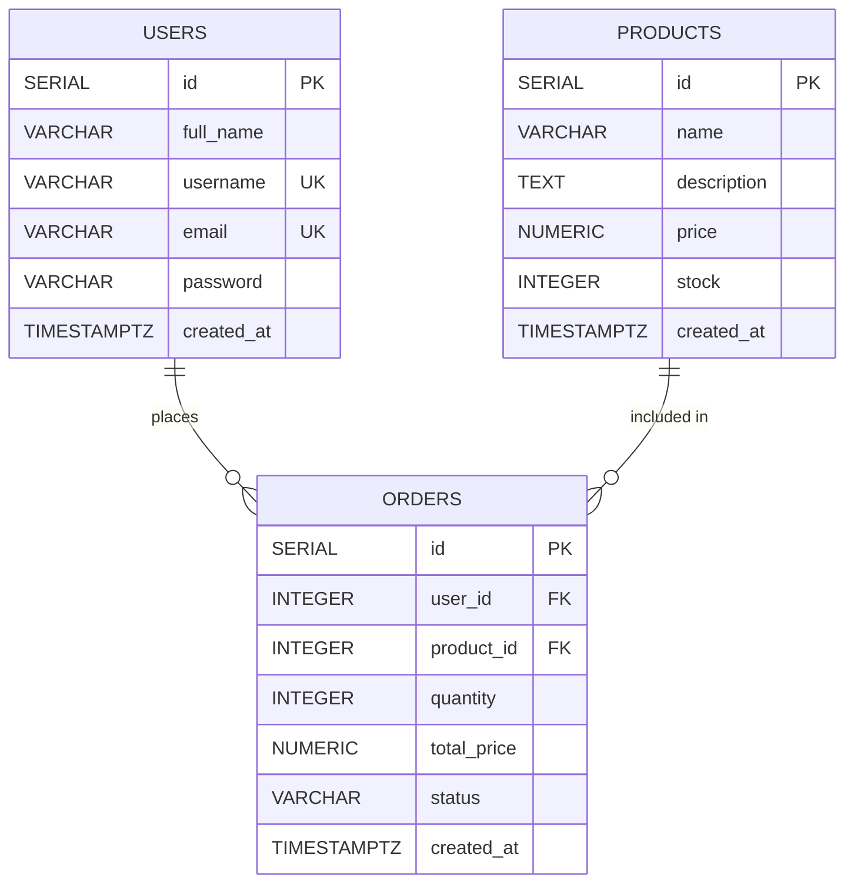

# Task 1.1: Data Model and API Specification

Project: E-Commerce Inventory & Order API  
Database: PostgreSQL  
Stack: Node.js, Express, `pg`  

---

## 1. Entity Definitions (PostgreSQL Data Model)

The application data model consists of 3 related entities designed for an e-commerce inventory and order workflow:

### 1. `users` (Store Owners & Customers)
*Planned for Week 2 (Authentication & Ownership)*

| Column | Type | Constraints | Description |
|---|---|---|---|
| `id` | `SERIAL` | Primary Key | Unique user identifier |
| `full_name` | `VARCHAR(255)` | NOT NULL | User's legal or display name |
| `username` | `VARCHAR(100)` | NOT NULL, UNIQUE | Unique login username |
| `email` | `VARCHAR(255)` | NOT NULL, UNIQUE | User contact email |
| `password` | `VARCHAR(255)` | NOT NULL | Securely hashed password (bcrypt) |
| `created_at` | `TIMESTAMPTZ` | DEFAULT CURRENT_TIMESTAMP | Account creation timestamp |

### 2. `products` (Catalog Items)
*Week 1 Core Main Entity*

| Column | Type | Constraints | Description |
|---|---|---|---|
| `id` | `SERIAL` | Primary Key | Unique product identifier |
| `name` | `VARCHAR(255)` | NOT NULL | Product title/name |
| `description` | `TEXT` | NULL | Product details or specifications |
| `price` | `NUMERIC(10, 2)` | NOT NULL, CHECK (price >= 0) | Retail price in dollars/cents |
| `stock` | `INTEGER` | NOT NULL, DEFAULT 0, CHECK (stock >= 0) | Current available quantity in inventory |
| `created_at` | `TIMESTAMPTZ` | DEFAULT CURRENT_TIMESTAMP | Product entry timestamp |

### 3. `orders` (Purchases & Relational Bridge)
*Planned for Week 2 (Relationships & Stock Validation)*

| Column | Type | Constraints | Description |
|---|---|---|---|
| `id` | `SERIAL` | Primary Key | Unique order identifier |
| `user_id` | `INTEGER` | NOT NULL, REFERENCES users(id) ON DELETE CASCADE | Customer placing the order |
| `product_id` | `INTEGER` | NOT NULL, REFERENCES products(id) ON DELETE RESTRICT | Product being purchased |
| `quantity` | `INTEGER` | NOT NULL, CHECK (quantity > 0) | Units ordered |
| `total_price` | `NUMERIC(10, 2)` | NOT NULL | Computed line total (`quantity * unit price`) |
| `status` | `VARCHAR(50)` | NOT NULL, DEFAULT 'pending' | Order state (`pending`, `confirmed`, `cancelled`) |
| `created_at` | `TIMESTAMPTZ` | DEFAULT CURRENT_TIMESTAMP | Order creation timestamp |

---

## 2. Entity-Relationship Diagram (ERD)



### Relationship Summary
- **Users to Orders**: One-to-Many (`1:N`). A user can place zero or multiple orders; each order belongs to exactly one user.
- **Products to Orders**: One-to-Many (`1:N`). A product can be referenced in multiple order records; each individual line order references one product.
- **Referential Integrity**:
  - `ON DELETE RESTRICT` on `orders.product_id` prevents deleting products that are tied to existing order records.
  - `ON DELETE CASCADE` on `orders.user_id` cleans up orphaned order records if a test user account is removed.

---

## 3. Design Decisions

1. **Why PostgreSQL (Relational SQL) over NoSQL**:
   - Inventory tracking and order fulfillment require strict transactional integrity (ACID).
   - Foreign key constraints prevent orphaned records and protect catalog consistency.
   - Exact numeric pricing requires `NUMERIC(10, 2)` to eliminate floating-point arithmetic errors inherent in generic JSON storage.

2. **Why `products` was selected as Week 1 Main Entity**:
   - An e-commerce system is catalog-centric. Before users can create carts or purchase items, products must be created, cataloged, inventoried, and retrieved.

3. **Field Validation Decisions**:
   - `name` is required: Products cannot exist without an identifiable title.
   - `price` is required and must be `>= 0`: An item must have a non-negative cost.
   - `stock` defaults to `0` and must be non-negative: Products are tracked as out-of-stock rather than undefined.
   - Pagination parameters (`page` and `limit`) are sanitized with minimum bounds (`Math.max(1, ...)`) to prevent negative offset errors or server crashes.

---

## 4. REST API Specification (Main Entity: Products)

### Base URL
`http://localhost:3000` (Local) or Deployed URL

---

### Endpoint 1: Create Product
- **Method**: `POST`
- **Path**: `/products`
- **Purpose**: Add a new inventory item to the catalog.
- **Request Headers**: `Content-Type: application/json`
- **Request Body**:
```json
{
  "name": "Mechanical Keyboard",
  "description": "Tactile switch mechanical keyboard",
  "price": 89.99,
  "stock": 15
}
```
- **Responses**:
  - `201 Created`:
  ```json
  {
    "message": "Product created successfully",
    "product": {
      "id": 1,
      "name": "Mechanical Keyboard",
      "description": "Tactile switch mechanical keyboard",
      "price": "89.99",
      "stock": 15,
      "created_at": "2026-10-14T20:30:00.000Z"
    }
  }
  ```
  - `400 Bad Request` (Missing required fields):
  ```json
  {
    "message": "Product name is required"
  }
  ```

---

### Endpoint 2: List All Products (Paginated)
- **Method**: `GET`
- **Path**: `/products?page=1&limit=10`
- **Purpose**: Retrieve catalog items with pagination metadata.
- **Query Parameters**:
  - `page` (optional, default `1`): Current page number.
  - `limit` (optional, default `10`): Items per page (max 100).
- **Request Body**: None
- **Responses**:
  - `200 OK`:
  ```json
  {
    "data": [
      {
        "id": 1,
        "name": "Mechanical Keyboard",
        "description": "Tactile switch mechanical keyboard",
        "price": "89.99",
        "stock": 15,
        "created_at": "2026-10-14T20:30:00.000Z"
      }
    ],
    "page": 1,
    "limit": 10,
    "total": 1
  }
  ```

---

### Endpoint 3: Get Product By ID
- **Method**: `GET`
- **Path**: `/products/:id`
- **Purpose**: Fetch details for a specific item by its primary key.
- **URL Parameters**:
  - `id` (integer, required): Product ID.
- **Request Body**: None
- **Responses**:
  - `200 OK`:
  ```json
  {
    "id": 1,
    "name": "Mechanical Keyboard",
    "description": "Tactile switch mechanical keyboard",
    "price": "89.99",
    "stock": 15,
    "created_at": "2026-10-14T20:30:00.000Z"
  }
  ```
  - `400 Bad Request`:
  ```json
  {
    "message": "Invalid product ID"
  }
  ```
  - `404 Not Found`:
  ```json
  {
    "message": "Product not found"
  }
  ```

---

### Endpoint 4: Update Product
- **Method**: `PUT`
- **Path**: `/products/:id`
- **Purpose**: Modify an existing product's details or stock level.
- **URL Parameters**:
  - `id` (integer, required): Product ID.
- **Request Headers**: `Content-Type: application/json`
- **Request Body** (Partial or full updates):
```json
{
  "price": 79.99,
  "stock": 25
}
```
- **Responses**:
  - `200 OK`:
  ```json
  {
    "message": "Product updated successfully",
    "product": {
      "id": 1,
      "name": "Mechanical Keyboard",
      "description": "Tactile switch mechanical keyboard",
      "price": "79.99",
      "stock": 25,
      "created_at": "2026-10-14T20:30:00.000Z"
    }
  }
  ```
  - `400 Bad Request` (Invalid values):
  ```json
  {
    "message": "Price must be a valid positive number"
  }
  ```
  - `404 Not Found`:
  ```json
  {
    "message": "Product not found"
  }
  ```

---

### Endpoint 5: Delete Product
- **Method**: `DELETE`
- **Path**: `/products/:id`
- **Purpose**: Remove a product from the catalog.
- **URL Parameters**:
  - `id` (integer, required): Product ID.
- **Request Body**: None
- **Responses**:
  - `200 OK`:
  ```json
  {
    "message": "Product deleted successfully"
  }
  ```
  - `404 Not Found`:
  ```json
  {
    "message": "Product not found"
  }
  ```
